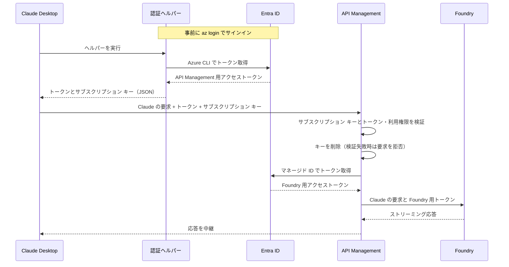
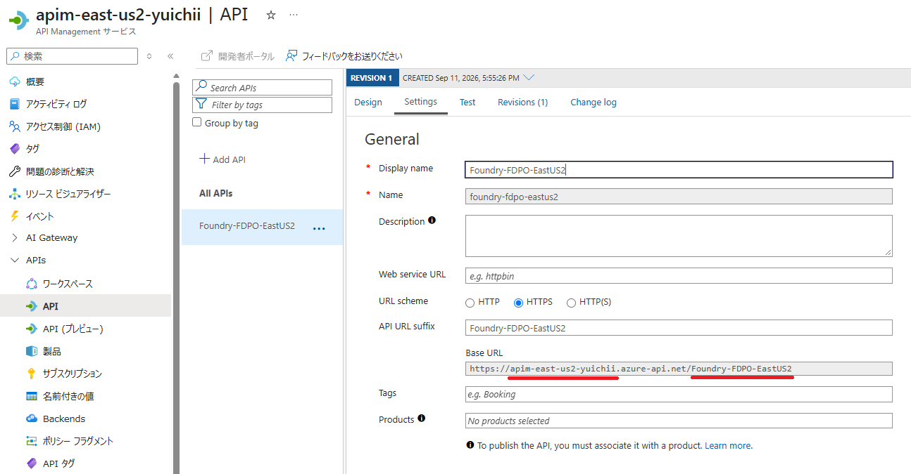

# Claude Desktop から Microsoft Foundry の Claude モデルを利用する（Entra ID 認証 + サブスクリプション キー）

## はじめに

開発者個人が Claude Desktop から Microsoft Foundry の Claude モデルに直接接続する場合は、[Microsoft Learn の Claude Desktop 設定手順](https://learn.microsoft.com/ja-jp/azure/foundry/foundry-models/how-to/configure-claude-desktop) を参照してください。

本資料では、[Claude Code 向けの手順書（Entra ID 認証 + サブスクリプション キー）](APIM_Entra_ID_KEY.md)（以下、既存手順書）で構成した [Azure API Management](https://azure.microsoft.com/ja-jp/products/api-management)（以下、APIM）を、**Windows 版 Claude Desktop のサードパーティ推論（3P）** から利用する手順を紹介します。既存手順書の「[3. 開発者 PC の設定](APIM_Entra_ID_KEY.md#3-開発者-pc-の設定)」に相当する内容です。

Microsoft Entra ID と APIM は、既存手順書の「[1. Microsoft Entra ID の設定](APIM_Entra_ID_KEY.md#1-microsoft-entra-id-の設定)」と「[2. API Management の設定](APIM_Entra_ID_KEY.md#2-api-management-の設定)」に従って設定済みとします。本資料では、開発者 PC の設定から推論の動作確認までを扱います。

> [!NOTE]
> 画面の項目名は、日本語表示の Windows 版 Claude Desktop を基に記載しています。項目名や配置は Claude Desktop の更新によって変わる場合があります。

## 目次

- [概要](#概要)
- [1. 前提条件と Azure CLI へのサインイン](#1-前提条件と-azure-cli-へのサインイン)
- [2. 認証ヘルパーの作成](#2-認証ヘルパーの作成)
- [3. Claude Desktop の接続とモデルの設定](#3-claude-desktop-の接続とモデルの設定)
- [4. 動作確認とトラブルシューティング](#4-動作確認とトラブルシューティング)

## 概要

Claude Desktop は、推論要求に資格情報が必要になると、開発者 PC に保存した **認証ヘルパー**（PowerShell スクリプト）を実行します。認証ヘルパーは Azure CLI で APIM 用のアクセス トークンを取得し、APIM のサブスクリプション キーとまとめて JSON で返します。Claude Desktop は、トークンを `Authorization: Bearer <トークン>` として送り、サブスクリプション キーを `Ocp-Apim-Subscription-Key` ヘッダーとして同じ要求に追加します。

APIM 側の処理は既存手順書と同じです。APIM はサブスクリプション キーとトークン・利用権限を検証し、**両方の検証に成功した要求だけ** を **APIM 自身のマネージド ID** で Foundry に転送します。



既存手順書の Claude Code の設定と、本資料の Claude Desktop の設定は、次のように対応します。

| 項目 | Claude Code（既存手順書） | Claude Desktop（本資料） |
| --- | --- | --- |
| Entra ID のトークン | `apiKeyHelper` の出力 | 認証ヘルパーが返す `token` |
| サブスクリプション キー | `ANTHROPIC_CUSTOM_HEADERS` | 認証ヘルパーが返す `headers` |
| APIM の接続先 | `ANTHROPIC_BASE_URL` | ［ゲートウェイ ベース URL］ |
| 利用するモデル | `ANTHROPIC_DEFAULT_*_MODEL` | ［モデルリスト］ |
| ヘルパー出力のキャッシュ期間 | `CLAUDE_CODE_API_KEY_HELPER_TTL_MS` | ［ヘルパースクリプトの TTL］ |

## 1. 前提条件と Azure CLI へのサインイン

### 1.1. 前提条件を確認する

- **Claude Desktop**: Windows 版をインストール済みであること。未インストールの場合は [Claude のダウンロード ページ](https://claude.com/download) からインストールします。
- **Azure CLI**: インストール済みであること。未インストールの場合は [公式のインストール手順](https://learn.microsoft.com/ja-jp/cli/azure/install-azure-cli) に従ってインストールします。本資料のコマンド例は PowerShell 用です。
- **APIM への接続**: 開発者 PC から Entra ID と APIM（`https://<APIM_NAME>.azure-api.net`）に接続できること。
- **`Claude.User` ロール**: 利用者が、既存手順書の [手順 1.5](APIM_Entra_ID_KEY.md#15-アプリ-ロールを作成し利用者に割り当てる) で認証用アプリの `Claude.User` ロールに割り当てられていること。
- **APIM サブスクリプション キー**: 既存手順書の [手順 2.3](APIM_Entra_ID_KEY.md#23-サブスクリプション-キーを必須にし利用者へ配布する) で配布された、有効な（状態が Active の）サブスクリプションのキーを入手していること。

あわせて、管理者から次の値を入手します。本資料のコード例では、それぞれ次のプレースホルダーで記載しています。

| 値 | プレースホルダー |
| --- | --- |
| ディレクトリ (テナント) ID | `TENANT_ID` |
| `Claude.Invoke` を公開した認証用アプリのアプリケーション (クライアント) ID | `API_APP_ID` |
| APIM サブスクリプション キー（Primary key または Secondary key） | `<APIM_SUBSCRIPTION_KEY>` |
| APIM のサービス名 | `<APIM_NAME>` |
| 対象 API の API URL suffix | `<API_URL_SUFFIX>` |
| 利用する Foundry のデプロイ名 | `<Sonnet のデプロイ名>` など |

### 1.2. Azure CLI でサインインする

**Claude Desktop を使う Windows ユーザー** で PowerShell を開き、対象テナントにサインインします。

```powershell
az login --tenant TENANT_ID --allow-no-subscriptions
```

`TENANT_ID` は、既存手順書の [手順 1.2](APIM_Entra_ID_KEY.md#12-アプリとテナントの-id-を控える) で控えたディレクトリ (テナント) ID に置き換えます。`--allow-no-subscriptions` は、Azure サブスクリプションへのアクセス権がない利用者でもサインインできるようにする指定です。

Azure CLI のサインイン情報は Windows ユーザーごとに保存され、Claude Desktop が実行する認証ヘルパーはこの情報を使ってトークンを取得します。別の Windows ユーザー（管理者アカウントなど）でサインインしても、Claude Desktop からは利用できません。

サインイン状態が有効な間は、再度サインインする必要はありません。認証ヘルパーはサインインを行わないため、サインインの有効期限切れや条件付きアクセスのサインイン頻度などでトークンを取得できなくなった場合は、このコマンドで再度サインインします。詳細は [リフレッシュ トークンの有効期間と失効](https://learn.microsoft.com/entra/identity-platform/refresh-tokens) を参照してください。

## 2. 認証ヘルパーの作成

### 2.1. ヘルパーを保存する

認証ヘルパーを `%USERPROFILE%\.claude\claude-apim-helper.ps1` として保存します。次のコマンドで保存先のフォルダーを作成し、メモ帳でファイルを開きます。新しいファイルを作成するか確認された場合は、［はい］を選択します。

```powershell
New-Item -ItemType Directory -Path "$env:USERPROFILE\.claude" -Force | Out-Null
notepad "$env:USERPROFILE\.claude\claude-apim-helper.ps1"
```

次のスクリプトを全文貼り付け、先頭の 3 つの値を置き換えて保存します。

```powershell
$tenantId = 'TENANT_ID'
$apiAppId = 'API_APP_ID'
$subscriptionKey = '<APIM_SUBSCRIPTION_KEY>'

try {
    $az = Get-Command az -CommandType Application -TotalCount 1 -ErrorAction Stop
    $scope = "api://$apiAppId/Claude.Invoke"
    $tokenLines = @(& $az.Path account get-access-token `
        --tenant $tenantId --scope $scope --query accessToken `
        --output tsv --only-show-errors 2>$null)

    if ($LASTEXITCODE -ne 0 -or $tokenLines.Count -ne 1 -or
        [string]::IsNullOrWhiteSpace($tokenLines[0])) {
        throw 'Azure CLI could not obtain a token. Run az login for the configured tenant and scope.'
    }

    $credential = [ordered]@{
        token   = $tokenLines[0].Trim()
        headers = @{ 'Ocp-Apim-Subscription-Key' = $subscriptionKey }
    }
    $json = $credential | ConvertTo-Json -Compress -ErrorAction Stop
    [Console]::Out.WriteLine($json)
    exit 0
}
catch {
    [Console]::Error.WriteLine($_.Exception.Message)
    exit 1
}
```

| 変数 | 設定する値 |
| --- | --- |
| `$tenantId` | Entra のディレクトリ (テナント) ID |
| `$apiAppId` | `Claude.Invoke` を公開した認証用アプリのアプリケーション (クライアント) ID。`api://` は付けません |
| `$subscriptionKey` | 配布された APIM サブスクリプション キー。Foundry の API キーではありません |

ヘルパーは次のように動作します。

- PATH 上の Azure CLI（`az`）を探し、`api://API_APP_ID/Claude.Invoke` スコープのアクセス トークンを取得します。既存手順書の `apiKeyHelper` と同じ `az account get-access-token` コマンドです。
- Azure CLI の終了コードと、出力がトークン 1 行だけであることを確認します。Azure CLI のエラー メッセージは、標準出力に混ざらないように破棄します。
- 成功時は、トークンとサブスクリプション キーを JSON にまとめて標準出力に 1 行だけ書き込み、終了コード `0` で終了します。
- 失敗時は、メッセージを標準エラー出力に書き込み、終了コード `1` で終了します。Claude Desktop は、標準エラー出力を診断用にログへ記録し、`0` 以外の終了コードを資格情報の取得失敗として扱います。
- サインイン（`az login`）は行わず、入力も求めません。トークンを取得できない場合はすぐに失敗するため、[手順 1.2](#12-azure-cli-でサインインする) のサインインをやり直します。

> [!WARNING]
> ヘルパーにはサブスクリプション キーが平文で保存されます。ファイルは自分のユーザー プロファイル配下に置いて他のユーザーが読み取れないようにし、リポジトリにコミットしたり、チャット・Issue・共有ログに貼り付けたりしないでください。組織で PowerShell のスクリプト ブロック ログを有効にしている場合は、ヘルパーの内容がイベント ログに記録されることがあります。キーをファイルに保存しない運用にする場合は、組織のシークレット管理の仕組みからキーを取得するようにヘルパーを変更してください。

### 2.2. ヘルパーの出力形式を確認する

成功時は、標準出力に次の形式の JSON オブジェクトを 1 件だけ返します。

```json
{"token":"<ENTRA_ACCESS_TOKEN>","headers":{"Ocp-Apim-Subscription-Key":"<APIM_SUBSCRIPTION_KEY>"}}
```

Claude Desktop は `token` を `Authorization: Bearer <トークン>` として送り、`headers` の `Ocp-Apim-Subscription-Key` を同じ要求に追加します。[Anthropic の認証ヘルパー仕様](https://claude.com/docs/third-party/claude-desktop/credential-helper) では、標準出力はトークンだけ、またはこの形式の JSON だけと定められています。ヘルパーを変更する場合も、標準出力にはこの JSON 以外（メッセージやログなど）を書き込まないでください。

サブスクリプション キーは、Claude Desktop のカスタム推論ヘッダー（`inferenceCustomHeaders`）ではなく、ヘルパーの `headers` で渡します。Anthropic の [設定リファレンス](https://claude.com/docs/third-party/claude-desktop/configuration) では、カスタム推論ヘッダーは資格情報を含まないルーティング用の値に使い、資格情報はヘルパーの `headers` で返すよう案内されています。同じ名前のヘッダーが両方にある場合は、ヘルパーの値が優先されます。

### 2.3. ヘルパーを単体で確認する

Claude Desktop に設定する前に、手順 1.2 と同じ Windows ユーザーの PowerShell でヘルパーを実行し、**終了コードと JSON の構造だけ** を確認します。次のコマンドは資格情報の値を画面に表示しません。

```powershell
$helper = Join-Path $env:USERPROFILE '.claude\claude-apim-helper.ps1'
$output = @(powershell.exe -NoProfile -File $helper)
$exitCode = $LASTEXITCODE

$result = [ordered]@{
    ExitCode    = $exitCode
    OutputLines = $output.Count
    IsJson      = $false
    TokenParts  = 0
    HeaderNames = ''
    HasKey      = $false
}

if ($exitCode -eq 0 -and $output.Count -gt 0) {
    try {
        $credential = ($output -join '') | ConvertFrom-Json -ErrorAction Stop
        $result.IsJson = $true
        $result.TokenParts = ([string]$credential.token).Split('.').Count
        $result.HeaderNames = ($credential.headers.PSObject.Properties.Name -join ', ')
        $result.HasKey = -not [string]::IsNullOrWhiteSpace(
            [string]$credential.headers.'Ocp-Apim-Subscription-Key')
    }
    catch {
        # JSON ではない出力は表示しない
    }
}

[pscustomobject]$result
Remove-Variable output, credential -ErrorAction SilentlyContinue
```

次の結果になれば成功です。

| 項目 | 期待する値 | 意味 |
| --- | --- | --- |
| `ExitCode` | `0` | ヘルパーが正常に終了した |
| `OutputLines` | `1` | 標準出力が 1 行だけ |
| `IsJson` | `True` | 出力を JSON として解析できた |
| `TokenParts` | `3` | `token` が JWT の形式（`.` で区切られた 3 つの部分）になっている |
| `HeaderNames` | `Ocp-Apim-Subscription-Key` | `headers` に含まれるヘッダー名 |
| `HasKey` | `True` | サブスクリプション キーが空でない |

`ExitCode` が `1` の場合は、ヘルパーが標準エラー出力に書き込んだメッセージが結果の前に表示されます。`Azure CLI could not obtain a token` と表示された場合は、手順 1.2 のサインインと、ヘルパーの `$tenantId` と `$apiAppId` を確認します。それ以外のメッセージは、[手順 4.4](#44-エラー別の確認箇所) を参照してください。

このコマンドはトークンの取得と出力形式を確認するもので、トークンの内容やサブスクリプション キーが正しいかは確認しません。トークンのクレームは既存手順書の [手順 4.1](APIM_Entra_ID_KEY.md#41-アクセス-トークンを取得しクレームを確認する) で、APIM への接続は [手順 4.3](#43-claude-desktop-を介さずに-apim-を呼び出す) で確認できます。

> [!WARNING]
> ヘルパーを `& $helper` や `.\claude-apim-helper.ps1` のように、開いている PowerShell の中で直接実行しないでください。ヘルパーは標準出力に直接書き込むため、トークンとサブスクリプション キーがそのまま画面に表示されます。

## 3. Claude Desktop の接続とモデルの設定

### 3.1. サードパーティ推論の設定画面を開く

[Microsoft Learn の Claude Desktop 設定手順](https://learn.microsoft.com/ja-jp/azure/foundry/foundry-models/how-to/configure-claude-desktop) と同じ方法で、設定画面を開きます。Anthropic アカウントにはサインインせずに操作します。

1. Claude Desktop を起動し、［ヘルプ］→［トラブルシューティング］→［開発者モードを有効にする］を選択します。Windows では、サインイン画面の左上にあるメニュー（☰）から［ヘルプ］を開きます。
2. ［開発者］→［サードパーティ推論を構成する］を選択し、［サードパーティ推論の設定］画面を開きます。
3. 左側の一覧で［接続］を選択します。手順 3.2〜3.4 の項目は、すべて［接続］で設定します。

> [!NOTE]
> Microsoft Learn の手順は、推論プロバイダーに Foundry を選んで Foundry に直接接続する例です。本資料では APIM を経由するため、推論プロバイダーに Gateway を選びます。組織が MDM などで構成を配布している PC では、この画面は読み取り専用で開きます。

### 3.2. 接続先と認証情報を設定する

［接続］で、次のように設定します。

| 画面の項目 | 設定値 |
| --- | --- |
| 推論プロバイダー | `Gateway` |
| 認証情報の種類 | ヘルパースクリプト |
| ゲートウェイ ベース URL | `https://<APIM_NAME>.azure-api.net/<API_URL_SUFFIX>/anthropic` |
| ゲートウェイ認証スキーム | `bearer` |
| ヘルパースクリプト | `claude-apim-helper.ps1` の実際の絶対パス |
| ヘルパースクリプト（Windows）と引数 | 空欄 |
| ヘルパースクリプトの TTL | 設定例は `3600` 秒（[手順 3.3](#33-ヘルパーのキャッシュと再実行を設定する) を参照） |
| 認証情報ヘルパーのタイムアウト | `60` 秒 |
| サイレントリフレッシュのヘルパーを再実行 | オン |
| モデル検出 | オフ |

#### 推論プロバイダーと認証情報の種類

［Gateway］は、Anthropic Messages API 互換のゲートウェイに接続する推論プロバイダーです。既存手順書の APIM は、独自のアプリ登録（`api://API_APP_ID/Claude.Invoke`）のトークンとアプリ ロールを検証するため、［Foundry］ではなく［Gateway］を選びます。［認証情報の種類］に［ヘルパースクリプト］を選ぶと、手順 2 で作成したヘルパーの出力が資格情報として使われます。

参考資料：[Anthropic の Gateway 設定](https://claude.com/docs/third-party/claude-desktop/gateway)

#### ゲートウェイ ベース URL

Claude Desktop は、ベース URL の末尾に `/v1/messages` を付けて要求を送信します。既存手順書の [手順 2.1](APIM_Entra_ID_KEY.md#21-anthropic-互換-api-をインポートする) でインポートした API の操作 `POST /anthropic/v1/messages` に合わせて、ベース URL の末尾を `/anthropic` にします。

| 送信先 URL の部分 | 入力する場所 | 対応する APIM の設定 |
| --- | --- | --- |
| `https://<APIM_NAME>.azure-api.net/<API_URL_SUFFIX>` | ベース URL | 対象 API の **Base URL**（API URL suffix を含む） |
| `/anthropic` | ベース URL | 操作のパスの先頭 |
| `/v1/messages` | Claude Desktop が付加 | 操作のパスの残り |

その結果、要求は `https://<APIM_NAME>.azure-api.net/<API_URL_SUFFIX>/anthropic/v1/messages` に送信され、APIM の操作 `POST /anthropic/v1/messages` で受け付けられます。

APIM ポータルで対象 API の **Settings** を開き、**Base URL** を確認します。この値の末尾に `/anthropic` を付けたものが、ゲートウェイ ベース URL です。



ベース URL に `/v1` や `/v1/messages` を含めないでください。APIM の操作のパスを変更した場合は、`/v1/messages` を除いた部分をベース URL の末尾に合わせます。

#### ゲートウェイ認証スキーム

`bearer` を選ぶと、ヘルパーが返す `token` が `Authorization: Bearer <トークン>` ヘッダーで送信されます。既存手順書の APIM ポリシー（`validate-azure-ad-token`）は `Authorization` ヘッダーのトークンを検証するため、`x-api-key` は選ばないでください。

#### ヘルパースクリプト

環境変数（`%USERPROFILE%` など）を含まない、実際の絶対パスを入力します。次のコマンドで確認できます。

```powershell
(Resolve-Path "$env:USERPROFILE\.claude\claude-apim-helper.ps1").Path
```

`C:\Users\<ユーザー名>\.claude\claude-apim-helper.ps1` のようなパスが表示されます。

［ヘルパースクリプト（Windows）］は、1 つの構成を Windows と macOS・Linux で共用する場合に、Windows 用のパスを別に指定する項目です。本資料では［ヘルパースクリプト］に Windows のパスを指定するため、空欄にします。このヘルパーは引数を使わないため、引数も空欄にします。

> [!WARNING]
> サブスクリプション キーなどの資格情報を、引数で渡さないでください。引数は Claude Desktop の診断レポートや、PC 上の他のプロセスから参照できます。

#### モデル検出

モデル検出をオンにすると、Claude Desktop はゲートウェイの `GET /v1/models` からモデルの一覧を取得します。既存手順書の APIM はこの操作を使わない構成のため、オフにして、[手順 3.4](#34-モデルリストを登録する) でモデルリストを手動で登録します。

### 3.3. ヘルパーのキャッシュと再実行を設定する

#### ヘルパースクリプトの TTL

ヘルパーの出力（トークンとサブスクリプション キー）を Claude Desktop がキャッシュする期間（秒）です。トークン自体の有効期間を延ばす設定ではありません。設定例の `3600` 秒（60 分）は既定値です。TTL が切れると、Claude Desktop は次の要求を送る前にヘルパーを再実行します。

Azure CLI は有効なトークンをキャッシュから再利用するため、ヘルパーが返すトークンの残りの有効期間は一定ではなく、TTL より短い場合があります。[Azure CLI のコマンド リファレンス](https://learn.microsoft.com/cli/azure/account#az-account-get-access-token) では、取得したトークンは少なくとも 5 分間有効と説明されています。キャッシュ中にトークンの有効期限が切れると APIM は `401` を返しますが、［サイレントリフレッシュのヘルパーを再実行］がオンであれば、Claude Desktop はヘルパーを再実行して新しいトークンで再試行します。

トークンの有効期限は、トークンの値を表示せずに次のコマンドで確認できます（Azure CLI 2.54.0 以降）。

```powershell
$expiresOn = az account get-access-token --tenant TENANT_ID `
    --scope api://API_APP_ID/Claude.Invoke `
    --query expires_on --output tsv --only-show-errors
if ($LASTEXITCODE -ne 0) {
    throw 'アクセス トークンを取得できませんでした。'
}
[DateTimeOffset]::FromUnixTimeSeconds([long]$expiresOn).LocalDateTime
```

有効期限切れによるエラーが繰り返し表示される場合は、TTL をトークンの残りの有効期間より短くします。たとえば、既存手順書の Claude Code の設定と同じ `240` 秒（4 分）にすると、TTL が「少なくとも 5 分間」の有効期間に収まります。`120` 秒以下にすると、要求ごとの有効期限の確認が行われなくなるため、`121` 秒以上を指定します。

#### 認証情報ヘルパーのタイムアウト

ヘルパー 1 回の実行を待つ最大の秒数です。既定値の `60` 秒を指定します。このヘルパーはブラウザーでのサインインを行わないため、既定値で十分です。会話の途中でヘルパーを再実行する場合は、この設定にかかわらず 20 秒で打ち切られます。

#### サイレントリフレッシュのヘルパーを再実行

オンにすると、資格情報の有効期限切れや APIM からの `401` を検知したときに、Claude Desktop が利用者の操作なしでヘルパーを再実行します。このヘルパーは入力を求めずに終了するため、オンにします。

> [!NOTE]
> TTL とヘルパーの再実行で更新されるのはトークンです。サブスクリプション キーをローテーションした場合は、ヘルパーの `$subscriptionKey` を新しいキーに置き換え、Claude Desktop を再起動してください。

参考資料：[Anthropic の認証ヘルパー仕様](https://claude.com/docs/third-party/claude-desktop/credential-helper)

### 3.4. モデルリストを登録する

［モデルリスト］に、APIM が要求の `model` として受け付ける **完全なモデル ID** を手動で登録します。既存手順書の構成では、Foundry のデプロイ名を指定します。モデル検出がオフの場合、`sonnet` や `opus` のような短い名前（エイリアス）は使えません。

リストの先頭のモデルが、既定のモデルになります。次の設定例では、`claude-sonnet-5` と `claude-opus-5-5` の 2 つを登録し、`claude-sonnet-5` を既定のモデルにしています。いずれも画面の設定例のため、実際の Foundry のデプロイ名に置き換えてください。

| 画面の項目 | 設定例 | 説明 |
| --- | --- | --- |
| モデル ID | `claude-sonnet-5` | 必須。Foundry に実在するデプロイ名を指定します |
| 表示名 | `claude-sonnet-5` | モデルの選択画面に表示する名前。空欄の場合は ID から自動で作られます |
| 1M コンテキストバリアントを提供 | オン | 100 万トークンのコンテキストの選択肢を追加します |
| 1M オプションのみを表示 | オフ | オンにすると、1M コンテキストの選択肢だけを表示します |
| ティアエイリアス | `sonnet` | このモデルが担当する Claude のティア（`sonnet`、`opus` など） |
| ティアのデフォルト | オフ | 同じティアに複数のモデルを登録した場合に、既定にするモデルでオンにします |
| この ID に対応する Claude モデル | 空欄 | デプロイ名から Claude のモデルを判別できない場合に、対応する Claude のモデルを指定します。そのモデルのエフォート レベルと制限が適用されます |
| 最大エフォート | `max` | このモデルで選択できる最も高いエフォート レベル |

2 つ目のエントリーには、モデル ID と表示名に `claude-opus-5-5` を設定し、［ティアエイリアス］に `opus` を指定します。

1M コンテキストや最大エフォートなどの任意の設定は、対象のデプロイの対応状況に合わせてください。1M コンテキストに対応していないデプロイで［1M コンテキストバリアントを提供］をオンにすると、1M の選択肢からの要求はエラーになります。

参考資料：[Anthropic のモデル設定](https://claude.com/docs/third-party/claude-desktop/models)

## 4. 動作確認とトラブルシューティング

### 4.1. 接続をテストし、設定を適用する

1. ［接続］の設定とモデルリストを入力したら、［接続をテスト］を選択します。Claude Desktop がヘルパーを実行し、入力した設定で APIM に接続できることを確認します。失敗した場合は、表示されたエラーに応じて [手順 4.4](#44-エラー別の確認箇所) を確認します。
2. テストに成功したら、画面右下の［変更を適用］を選択します。設定は、この PC のこの Windows ユーザーにだけ適用されます。
3. 保存と再起動の確認が表示されたら、保存して再起動します（英語表示では **Save & Restart**）。Claude Desktop が自動で起動し直さない場合は、Claude Desktop を完全に終了してから起動します。

### 4.2. 推論を確認する

1. 再起動後のサインイン画面で、サードパーティ推論（3P）で開始する項目（Microsoft Learn の例では［3P で Cowork で開始］）を選択します。Anthropic のサインインを選ぶと、通常の Claude Desktop として起動します。
2. 新しいチャットまたは Cowork のタスクを開始し、モデルの選択画面で手順 3.4 で登録したモデルを選びます。リストの先頭に登録したモデルが、既定で選択されています。
3. 短いプロンプト（例: `こんにちは。1 文で自己紹介してください。`）を送信し、応答が返ることを確認します。
4. 複数のモデルを登録した場合は、ほかのモデルでも同様に確認します。

APIM の管理者は、既存手順書の [手順 2.5](APIM_Entra_ID_KEY.md#25-利用状況のログを設定する) で設定したログで、対象のサブスクリプションからの要求が記録されていることを確認できます。

### 4.3. Claude Desktop を介さずに APIM を呼び出す

接続テストや推論が失敗する場合は、ヘルパーの出力を使って PowerShell から APIM を直接呼び出し、APIM 側と Claude Desktop 側のどちらの問題かを切り分けます。手順 2.3 の確認に成功してから、`<APIM_NAME>`、`<API_URL_SUFFIX>`、`<Sonnet のデプロイ名>` を実際の値に置き換えて実行します。トークンとサブスクリプション キーの値は表示しません。

```powershell
$helper = Join-Path $env:USERPROFILE '.claude\claude-apim-helper.ps1'
$baseUrl = 'https://<APIM_NAME>.azure-api.net/<API_URL_SUFFIX>/anthropic'
$model = '<Sonnet のデプロイ名>'

$output = @(powershell.exe -NoProfile -File $helper)
if ($LASTEXITCODE -ne 0) {
    throw 'ヘルパーが失敗しました。手順 2.3 で確認してください。'
}
try {
    $credential = ($output -join '') | ConvertFrom-Json -ErrorAction Stop
}
catch {
    throw 'ヘルパーの出力を JSON として解析できませんでした。手順 2.3 で確認してください。'
}

$headers = @{
    'Authorization'             = 'Bearer ' + $credential.token
    'Ocp-Apim-Subscription-Key' = $credential.headers.'Ocp-Apim-Subscription-Key'
    'anthropic-version'         = '2023-06-01'
}
$body = @{
    model      = $model
    max_tokens = 256
    messages   = @(@{ role = 'user'; content = 'How are you?' })
} | ConvertTo-Json -Depth 5

try {
    $response = Invoke-RestMethod -Method Post -Uri "$baseUrl/v1/messages" `
        -Headers $headers -ContentType 'application/json' -Body $body
    $response.content | Where-Object { $_.type -eq 'text' } | ForEach-Object { $_.text }
}
catch {
    if ($_.Exception.Response) { 'HTTP ' + [int]$_.Exception.Response.StatusCode }
    if ($_.ErrorDetails.Message) { $_.ErrorDetails.Message } else { $_.Exception.Message }
}
```

- **応答のテキストが表示される場合**: APIM と Foundry は正常に動作しています。Claude Desktop の［ゲートウェイ ベース URL］、［ゲートウェイ認証スキーム］、［モデルリスト］の値が、このコマンドの値と一致しているかを確認します。
- **エラーが表示される場合**: 表示された HTTP ステータスとメッセージを基に、[手順 4.4](#44-エラー別の確認箇所) を確認します。

確認が終わったら、この PowerShell を閉じてください。

### 4.4. エラー別の確認箇所

| 症状 | 確認する箇所 |
| --- | --- |
| ヘルパーが失敗し、`Azure CLI could not obtain a token` と表示される | **Azure CLI のサインイン先**: Claude Desktop と同じ Windows ユーザーで、`$tenantId` のテナントにサインインしているか（[手順 1.2](#12-azure-cli-でサインインする)）。サインインの有効期限が切れている場合は、`az login` をやり直します<br>**`Claude.Invoke` スコープ**: ヘルパーの `$apiAppId` が、`Claude.Invoke` を公開した認証用アプリのアプリケーション ID か。既存手順書の [手順 1.3](APIM_Entra_ID_KEY.md#13-api-を公開しスコープを追加する) と [手順 1.4](APIM_Entra_ID_KEY.md#14-azure-cli-をクライアントとして事前承認する) で、スコープの公開と Azure CLI の事前承認が済んでいるか |
| ヘルパーが失敗し、`az` が認識されない旨のメッセージが表示される | Azure CLI がインストールされ、Claude Desktop を使う Windows ユーザーの PATH に含まれているか。インストール直後の場合は、Claude Desktop を完全に終了してから起動し直します |
| ヘルパーが失敗し、スクリプトの実行が無効になっている旨のメッセージが表示される | PowerShell の実行ポリシー（`Get-ExecutionPolicy -List` で確認）。組織のポリシーに従って、ヘルパーを実行できるようにします |
| ヘルパーがタイムアウトする | Entra ID（`login.microsoftonline.com`）に接続できるか。プロキシ環境では Azure CLI のプロキシ設定も確認します。必要に応じて［認証情報ヘルパーのタイムアウト］を延ばします |
| `401` と `subscription key` を含むメッセージ（`Access denied due to missing subscription key` など） | **APIM サブスクリプション キー**: ヘルパーの `$subscriptionKey` が配布されたキーと一致し、サブスクリプションの状態が Active か。キーがローテーションされていないか。対象 API の **Subscription required** が想定どおりか（既存手順書の [手順 2.3](APIM_Entra_ID_KEY.md#23-サブスクリプション-キーを必須にし利用者へ配布する)） |
| `401`（`Unauthorized`） | **トークンの検証**: トークンのテナント、`aud`、`scp`（`Claude.Invoke`）が APIM ポリシーの値と一致するか。既存手順書の [手順 4.1](APIM_Entra_ID_KEY.md#41-アクセス-トークンを取得しクレームを確認する) でクレームを確認します<br>**`Claude.User` ロール**: トークンの `roles` に `Claude.User` が含まれているか。ロールを割り当てた直後の場合は、時間をおいてトークンを取り直します |
| `403` | **Foundry 側の権限**: APIM のマネージド ID に、Foundry リソースの **Cognitive Services User** ロールが付与されているか（既存手順書の手順 2.1） |
| `404`（`Resource not found` など） | **ベース URL**: ［ゲートウェイ ベース URL］が `https://<APIM_NAME>.azure-api.net/<API_URL_SUFFIX>/anthropic` の形式か。`/v1` を含めていないか、API URL suffix と操作のパスが APIM の設定と一致するか（[手順 3.2](#32-接続先と認証情報を設定する)） |
| `404`、`400` などでモデルやデプロイが見つからない旨のメッセージが表示される | **モデル ID**: モデルリストの ID が、Foundry に実在するデプロイ名と完全に一致するか。表示名ではなく［モデル ID］を確認します（[手順 3.4](#34-モデルリストを登録する)） |
| 1M コンテキストや特定のエフォート レベルを選んだときだけ失敗する | 対象のデプロイが、その設定に対応しているか。対応していない場合は、モデルリストの該当する設定をオフにするか変更します |
| 接続テストは成功するが、応答が途中で止まる | APIM のポリシーで応答をバッファリングせず、ストリーミング応答を中継できるか（既存手順書の手順 2.5 のログ設定を参照） |

接続テストのエラーだけでは原因が分からない場合は、［ヘルプ］→［トラブルシューティング］から診断レポートを生成し、推論プロバイダーの設定の状態や、ヘルパーが標準エラー出力に書き込んだメッセージを確認します。

> [!WARNING]
> 診断レポートやログ、スクリーンショットを共有する場合は、アクセス トークン、サブスクリプション キー、プロンプト内の機密情報が含まれていないことを確認してください。
