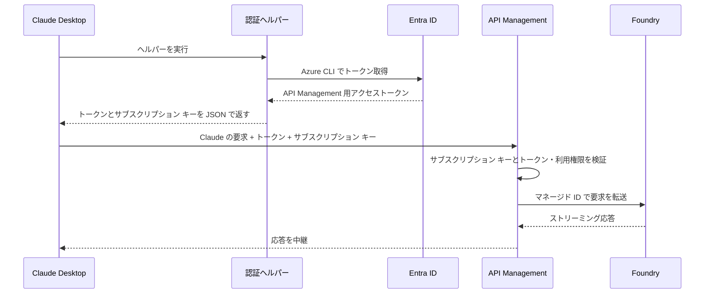

# Claude Desktop から Microsoft Foundry の Claude モデルを利用する（Entra ID 認証 + サブスクリプション キー）

## はじめに

開発者個人が Claude Desktop から Microsoft Foundry の Claude モデルを直接利用する場合は、[Microsoft の公式ドキュメント](https://learn.microsoft.com/ja-jp/azure/foundry/foundry-models/how-to/configure-claude-desktop) を参照してください。

本資料は、[Entra ID 認証 + サブスクリプション キー](APIM_Entra_ID_KEY.md) の構成を **Windows 版 Claude Desktop** から利用する手順です。Claude Desktop のサードパーティ推論（以下、3P）を設定し、Azure API Management（以下、APIM）経由で Microsoft Foundry の Claude モデルを利用します。

Entra ID と APIM は、[APIM_Entra_ID_KEY.md](APIM_Entra_ID_KEY.md) の [1. Microsoft Entra ID の設定](APIM_Entra_ID_KEY.md#1-microsoft-entra-id-の設定) と [2. API Management の設定](APIM_Entra_ID_KEY.md#2-api-management-の設定) に従って設定済みとします。本資料では、Claude Code 向けの [3. 開発者 PC の設定](APIM_Entra_ID_KEY.md#3-開発者-pc-の設定) に相当する、開発者 PC の設定から推論の動作確認までを説明します。

## 目次

- [概要](#概要)
- [前提条件](#前提条件)
- [1. Azure CLI でサインインする](#1-azure-cli-でサインインする)
- [2. 認証ヘルパーを作成する](#2-認証ヘルパーを作成する)
- [3. Claude Desktop の接続とモデルを設定する](#3-claude-desktop-の接続とモデルを設定する)
- [4. 動作を確認する](#4-動作を確認する)
- [5. トラブルシューティング](#5-トラブルシューティング)

## 概要

Claude Desktop の推論プロバイダーに **Gateway** を選び、APIM を Anthropic Messages API 互換のゲートウェイとして接続します。認証情報には、開発者 PC 上の **認証ヘルパー**（PowerShell スクリプト）を使います。Claude Desktop は認証情報が必要になるとヘルパーを実行し、ヘルパーは Azure CLI で APIM 用のアクセス トークンを取得して、トークンと APIM のサブスクリプション キーを JSON で返します。

Claude Desktop は、各要求に `Authorization: Bearer <アクセス トークン>` と `Ocp-Apim-Subscription-Key: <サブスクリプション キー>` の両方を付けて APIM に送信します。APIM 側の設定は Claude Code と共通で、**両方の検証に成功した要求だけ**を APIM 自身のマネージド ID で Foundry に転送します。トークンだけ、またはキーだけでは利用できません。



Claude Code 向けの [手順 3.2](APIM_Entra_ID_KEY.md#32-claude-code-のユーザー設定を追加する) の設定とは、次のように対応します。ベース URL とモデルのデプロイ名は、Claude Code と同じ値を使用できます。

| 用途 | Claude Code | Claude Desktop（本資料） |
| --- | --- | --- |
| 設定する場所 | `%USERPROFILE%\.claude\settings.json` | ［サードパーティ推論の設定］画面 |
| APIM の URL | `ANTHROPIC_BASE_URL` | ゲートウェイ ベース URL |
| Entra ID トークンの取得 | `apiKeyHelper` | 認証ヘルパーが返す `token` |
| サブスクリプション キーの送信 | `ANTHROPIC_CUSTOM_HEADERS` | 認証ヘルパーが返す `headers` |
| ヘルパー出力のキャッシュ期間 | `CLAUDE_CODE_API_KEY_HELPER_TTL_MS`（ミリ秒） | ヘルパースクリプトの TTL（秒） |
| 利用するモデル | `ANTHROPIC_DEFAULT_*_MODEL` | モデルリスト |

> [!NOTE]
> Claude Desktop には、ゲートウェイ向けに Entra ID などの ID プロバイダーへアプリ自身がサインインする方式もあります。本資料では、Azure CLI のクライアント ID を検証する既存の APIM ポリシー（[APIM_Entra_ID_KEY.md の手順 2.2](APIM_Entra_ID_KEY.md#22-ユーザーのアクセス-トークンを検証する)）をそのまま使うため、Azure CLI でトークンを取得する認証ヘルパーを使います。

## 前提条件

本資料は、開発者 PC で Claude Desktop を設定する手順を中心に説明します。Entra ID と APIM の設定手順は [APIM_Entra_ID_KEY.md](APIM_Entra_ID_KEY.md) を、MDM などによる Claude Desktop の組織への一括展開は [Anthropic のドキュメント](https://claude.com/docs/third-party/claude-desktop/installation) を参照してください。

- **Entra ID と APIM**: [APIM_Entra_ID_KEY.md](APIM_Entra_ID_KEY.md) の手順 1・2 に従い、認証用アプリ（`Claude.Invoke` スコープ、Azure CLI の事前承認、`Claude.User` ロール）、APIM のトークン検証ポリシー、サブスクリプション キーの必須化を設定済みであること。
- **開発端末**: Claude Desktop と Azure CLI をインストール済みの Windows PC。本資料のコマンド例は PowerShell 用です。
  - Claude Desktop が未インストールの場合は、[claude.com/download](https://claude.com/download) からダウンロードしてインストールしてください。
  - Azure CLI が未インストールの場合は、[公式のインストール手順](https://learn.microsoft.com/ja-jp/cli/azure/install-azure-cli) に従ってインストールしてください。
- **接続性**: 開発端末から Entra ID と APIM へ接続できること。
- **利用者の権限**: Claude Desktop を使う利用者の Entra ID アカウントが、認証用アプリの `Claude.User` ロールに割り当てられていること（[APIM_Entra_ID_KEY.md の手順 1.5](APIM_Entra_ID_KEY.md#15-アプリ-ロールを作成し利用者に割り当てる)）。
- **サブスクリプション キー**: [APIM_Entra_ID_KEY.md の手順 2.3](APIM_Entra_ID_KEY.md#23-サブスクリプション-キーを必須にし利用者へ配布する) で配布された、有効な APIM サブスクリプション キー（対象 API の Primary key または Secondary key）を入手していること。
- **モデル**: 利用する Claude モデルの、Foundry 上のデプロイ名を確認していること。

> [!NOTE]
> 画面の項目名は、2026 年 11 月時点の Windows 版 Claude Desktop（日本語表示）を基にしています。画面や項目は更新されるため、現在の表示と公式ドキュメントを確認してください。

## 1. Azure CLI でサインインする

### 1.1. 対象テナントにサインインする

**Claude Desktop を使う Windows ユーザー**で PowerShell を開き、設定した API のテナントを指定してサインインします。`--allow-no-subscriptions` は、Azure サブスクリプションへの権限がない利用者もサインインできるようにする指定です。`TENANT_ID` は、[APIM_Entra_ID_KEY.md の手順 1.2](APIM_Entra_ID_KEY.md#12-アプリとテナントの-id-を控える) で控えたディレクトリ (テナント) ID に置き換えます。

```powershell
az login --tenant TENANT_ID --allow-no-subscriptions
```

認証ヘルパーは、Claude Desktop を実行している Windows ユーザーの Azure CLI のサインイン状態を使ってトークンを取得します。別の Windows ユーザー（管理者用の別アカウントなど）でサインインしても、Claude Desktop からは利用できません。サインイン状態の有効期間と再サインインが必要になる条件は、Claude Code の場合（[APIM_Entra_ID_KEY.md の手順 3.3](APIM_Entra_ID_KEY.md#33-トークンのキャッシュと再サインイン)）と同じです。

### 1.2. トークンを取得できることを確認する

`TENANT_ID` と `API_APP_ID` を [APIM_Entra_ID_KEY.md の手順 1.2](APIM_Entra_ID_KEY.md#12-アプリとテナントの-id-を控える) の値に置き換えて実行します。`--query expiresOn` を指定しているため、トークン自体は表示せず、有効期限だけを表示します。

```powershell
az account get-access-token --tenant TENANT_ID --scope api://API_APP_ID/Claude.Invoke --query expiresOn --output tsv
```

有効期限が表示されれば、手順 2 の認証ヘルパーも同じスコープのトークンを取得できます。エラーが表示された場合は、[5. トラブルシューティング](#5-トラブルシューティング) を参照してください。トークンのクレーム（`aud`、`scp`、`roles`）を確認する場合は、[APIM_Entra_ID_KEY.md の手順 4.1](APIM_Entra_ID_KEY.md#41-アクセス-トークンを取得しクレームを確認する) を参照してください。

## 2. 認証ヘルパーを作成する

### 2.1. ヘルパーを保存する

認証ヘルパーは、Claude Desktop が実行する PowerShell スクリプトです。Azure CLI で APIM 用のアクセス トークンを取得し、トークンとサブスクリプション キーを標準出力に JSON で返します。本資料では `%USERPROFILE%\.claude\claude-apim-helper.ps1` に保存します。

PowerShell で次を実行し、保存先のフォルダーを作成して、メモ帳でファイルを開きます。ファイルの作成を確認された場合は［はい］を選択します。

```powershell
$helperDir = Join-Path $env:USERPROFILE '.claude'
New-Item -ItemType Directory -Path $helperDir -Force | Out-Null
notepad (Join-Path $helperDir 'claude-apim-helper.ps1')
```

次のスクリプトを貼り付け、先頭の 3 つの変数を実際の値に置き換えて保存します。

```powershell
$tenantId = 'TENANT_ID'
$apiAppId = 'API_APP_ID'
$subscriptionKey = '<APIM_SUBSCRIPTION_KEY>'

try {
    $az = Get-Command az -CommandType Application -TotalCount 1 -ErrorAction Stop
    $scope = "api://$apiAppId/Claude.Invoke"
    $tokenLines = @(& $az.Path account get-access-token `
        --tenant $tenantId --scope $scope --query accessToken `
        --output tsv --only-show-errors 2>$null)

    if ($LASTEXITCODE -ne 0 -or $tokenLines.Count -ne 1 -or
        [string]::IsNullOrWhiteSpace($tokenLines[0])) {
        throw 'Azure CLI could not obtain a token. Run az login for the configured tenant and scope.'
    }

    $credential = [ordered]@{
        token   = $tokenLines[0].Trim()
        headers = @{ 'Ocp-Apim-Subscription-Key' = $subscriptionKey }
    }
    $json = $credential | ConvertTo-Json -Compress -ErrorAction Stop
    [Console]::Out.WriteLine($json)
    exit 0
}
catch {
    [Console]::Error.WriteLine($_.Exception.Message)
    exit 1
}
```

| 変数 | 設定する値 |
| --- | --- |
| `$tenantId` | Entra テナント ID。[APIM_Entra_ID_KEY.md の手順 1.2](APIM_Entra_ID_KEY.md#12-アプリとテナントの-id-を控える) で控えたディレクトリ (テナント) ID |
| `$apiAppId` | `Claude.Invoke` を公開した認証用アプリのアプリケーション (クライアント) ID。同じく手順 1.2 で控えた値 |
| `$subscriptionKey` | [APIM_Entra_ID_KEY.md の手順 2.3](APIM_Entra_ID_KEY.md#23-サブスクリプション-キーを必須にし利用者へ配布する) で配布された APIM のサブスクリプション キー。Foundry の API キーではありません |

スクリプトの動作は次のとおりです。

- `az` コマンドの場所を確認し、`api://API_APP_ID/Claude.Invoke` スコープのアクセス トークンを取得します。Azure CLI のエラー出力は、標準出力に混ざらないように破棄します。
- トークンを取得できない場合は、標準エラー出力にメッセージを書き込み、終了コード `1` で終了します。ヘルパー自身は `az login` を実行しないため、サインインが必要な場合は [手順 1.1](#11-対象テナントにサインインする) でサインインし直します。
- 成功した場合は、トークンとサブスクリプション キーを 1 行の JSON にして標準出力に書き込み、終了コード `0` で終了します。

> [!WARNING]
> ヘルパーにはサブスクリプション キーが平文で保存されます。ファイルを共有フォルダーや同期フォルダーに置いたり、リポジトリへコミットしたり、チャット・Issue・共有ログへ貼り付けたりしないでください。組織で PowerShell のスクリプト ブロック ログを有効にしている場合は、ヘルパーの実行時にスクリプトの内容がイベント ログに記録されることがあります。ファイルへの保存を避ける場合は、組織のシークレット管理の仕組みからキーを取得するようにヘルパーを変更してください。

### 2.2. ヘルパーの出力形式を確認する

成功時は、標準出力に次の形式の JSON オブジェクトを 1 件だけ返します。

```json
{"token":"<ENTRA_ACCESS_TOKEN>","headers":{"Ocp-Apim-Subscription-Key":"<APIM_SUBSCRIPTION_KEY>"}}
```

Claude Desktop は `token` を `Authorization: Bearer <トークン>` として送り、`headers` の `Ocp-Apim-Subscription-Key` を同じ要求に追加します。

| JSON の項目 | APIM に送信されるヘッダー | APIM での検証 |
| --- | --- | --- |
| `token` | `Authorization: Bearer <トークン>` | トークンと利用権限（[APIM_Entra_ID_KEY.md の手順 2.2](APIM_Entra_ID_KEY.md#22-ユーザーのアクセス-トークンを検証する)） |
| `headers` の `Ocp-Apim-Subscription-Key` | `Ocp-Apim-Subscription-Key: <サブスクリプション キー>` | サブスクリプション キー（[APIM_Entra_ID_KEY.md の手順 2.3](APIM_Entra_ID_KEY.md#23-サブスクリプション-キーを必須にし利用者へ配布する)） |

Claude Desktop はヘルパーの標準出力全体を資格情報として読み取るため、標準出力には JSON 以外を書き込まないでください。スクリプトを変更する場合も、`Write-Host` や `Write-Output` で表示を追加しないでください。標準エラー出力の内容は診断のためにログへ記録されるため、資格情報の値を書き込まないでください。

サブスクリプション キーは、Claude Desktop のカスタム ヘッダーの設定（`inferenceCustomHeaders`）ではなく、ヘルパーの `headers` で返します。カスタム ヘッダーは構成情報としてそのまま保存・配布されるため、Anthropic のドキュメントでは、認証情報はカスタム ヘッダーに設定せず、ヘルパーから返すよう案内されています。同じ名前のヘッダーがある場合は、ヘルパーの値が優先されます。また、ヘルパーの引数は診断レポートや端末上の他のプロセスから参照できるため、キーやトークンを引数で渡さないでください。

参考資料：[認証ヘルパーの仕様](https://claude.com/docs/third-party/claude-desktop/credential-helper)、[認証ヘルパーの構成キー](https://claude.com/docs/third-party/claude-desktop/configuration#inferencecredentialhelper)

### 2.3. ヘルパーを単体で確認する

Claude Desktop に設定する前に、PowerShell からヘルパーを実行し、終了コードと JSON の構造を確認します。資格情報を画面やログに残さないよう、ヘルパーの出力は変数に格納し、値は表示しません。

```powershell
$helper = Join-Path $env:USERPROFILE '.claude\claude-apim-helper.ps1'

# 別プロセスでヘルパーを実行し、標準出力を変数に格納します（値は表示しません）
$output = @(powershell.exe -NoProfile -NonInteractive -ExecutionPolicy Bypass -File $helper)
$exitCode = $LASTEXITCODE
if ($exitCode -ne 0 -or $output.Count -ne 1) {
    throw "ヘルパーが失敗しました。終了コード: $exitCode、出力行数: $($output.Count)"
}

# JSON の構造だけを表示します
$credential = $output[0] | ConvertFrom-Json
[pscustomobject]@{
    ExitCode    = $exitCode
    JsonKeys    = $credential.PSObject.Properties.Name -join ', '
    TokenIsJwt  = ([string]$credential.token).Split('.').Count -eq 3
    HeaderNames = $credential.headers.PSObject.Properties.Name -join ', '
    HasKeyValue = -not [string]::IsNullOrWhiteSpace($credential.headers.'Ocp-Apim-Subscription-Key')
}
Remove-Variable output, credential
```

次のように表示されれば、ヘルパーは期待どおりの形式で資格情報を返しています。

```text
ExitCode    : 0
JsonKeys    : token, headers
TokenIsJwt  : True
HeaderNames : Ocp-Apim-Subscription-Key
HasKeyValue : True
```

- `-ExecutionPolicy Bypass` は、この確認のために起動する PowerShell プロセスにだけ適用され、端末の実行ポリシーは変更しません。
- この確認では、キーが APIM で有効かどうかまでは確認しません。トークンとキーの有効性は、[手順 4.1](#41-接続をテストし変更を適用する) の接続テストで確認します。
- 失敗した場合は、ヘルパーが標準エラー出力に書き込んだメッセージを確認し、[5. トラブルシューティング](#5-トラブルシューティング) を参照してください。

## 3. Claude Desktop の接続とモデルを設定する

### 3.1. サードパーティ推論の構成画面を開く

1. Claude Desktop を起動します。Anthropic アカウントでサインインしたり、アカウントを作成したりしないでください。
2. ［ヘルプ］→［トラブルシューティング］→［開発者モードを有効にする］を選択します。Windows では、サインイン画面の左上にあるアプリケーション メニュー（☰）から［ヘルプ］を開きます。
3. ［開発者］→［サードパーティ推論を構成する］を選択し、［サードパーティ推論の設定］画面を開きます。
4. 左側のサイドバーで［接続］を選択します。

画面の開き方と設定の適用手順は、[Microsoft Learn の Claude Desktop 設定手順](https://learn.microsoft.com/ja-jp/azure/foundry/foundry-models/how-to/configure-claude-desktop) も参考にしてください。Microsoft Learn の手順は Foundry に直接接続する構成のため、［接続］の設定値は本資料の手順 3.2 以降に従います。

> [!NOTE]
> MDM などで管理された構成が端末に配布されている場合、この画面は読み取り専用で開き、配布された値が表示されます。その場合は端末の管理者に確認してください。

### 3.2. 接続先と認証方式を設定する

［接続］で、推論プロバイダーと接続先を次のように設定します。

| 画面の項目 | 設定値 |
| --- | --- |
| 推論プロバイダー | `Gateway` |
| 認証情報の種類 | ヘルパースクリプト |
| ゲートウェイ ベース URL | `https://<APIM_NAME>.azure-api.net/<API_URL_SUFFIX>/anthropic` |
| ゲートウェイ認証スキーム | `bearer` |

- **推論プロバイダー**: APIM を Anthropic Messages API 互換のゲートウェイとして使うため、`Gateway` を選びます。`Foundry` は Foundry リソースに直接接続するためのプロバイダーです。
- **認証情報の種類**: ［ヘルパースクリプト］を選びます。ヘルパーを使う場合、ゲートウェイ API キーなどの固定の認証情報は使われないため、設定は不要です。
- **ゲートウェイ ベース URL**: Claude Code の `ANTHROPIC_BASE_URL` と同じ値です。`<APIM_NAME>` は APIM のサービス名（独自ドメインの場合はホスト名全体を変更）、`<API_URL_SUFFIX>` は対象 API の **API URL suffix** です。確認方法は [APIM_Entra_ID_KEY.md の手順 3.2](APIM_Entra_ID_KEY.md#32-claude-code-のユーザー設定を追加する) を参照してください。
- **ゲートウェイ認証スキーム**: `bearer` を選ぶと、ヘルパーの `token` が `Authorization: Bearer <トークン>` で送信されます。`x-api-key` を選ぶとトークンが `x-api-key` ヘッダーで送信されるため、`Authorization` ヘッダーを検証する APIM ポリシーで拒否されます。

Claude Desktop は、ゲートウェイ ベース URL の末尾に `/v1/messages` を付けて要求を送信します。APIM 側の操作パスとは次のように対応します。

| 項目 | 値 |
| --- | --- |
| ゲートウェイ ベース URL | `https://<APIM_NAME>.azure-api.net/<API_URL_SUFFIX>/anthropic` |
| Claude Desktop の要求先 | `https://<APIM_NAME>.azure-api.net/<API_URL_SUFFIX>/anthropic/v1/messages` |
| APIM の操作 | API URL suffix が `<API_URL_SUFFIX>` の API にある `POST /anthropic/v1/messages`（[APIM_Entra_ID_KEY.md の手順 2.1](APIM_Entra_ID_KEY.md#21-anthropic-互換-api-をインポートする)） |

ベース URL には `/v1` や `/v1/messages` を含めず、末尾に `/` を付けないでください。APIM の操作パスを変更した場合は、それに合わせて調整し、`/anthropic` や `/v1/messages` を重複させないでください。

### 3.3. 認証ヘルパーとモデル検出を設定する

同じ［接続］で、認証ヘルパーの実行方法とモデル検出を次のように設定します。

| 画面の項目 | 設定値 |
| --- | --- |
| ヘルパースクリプト | `claude-apim-helper.ps1` の実際の絶対パス |
| ヘルパースクリプト（Windows）と引数 | 空欄 |
| ヘルパースクリプトの TTL | 画面例は `3600` 秒。トークンの残存有効期間に応じて調整 |
| 認証情報ヘルパーのタイムアウト | `60` 秒 |
| サイレントリフレッシュのヘルパーを再実行 | オン |
| モデル検出 | オフ |

**ヘルパースクリプト** には、手順 2.1 で保存したファイルの絶対パスを入力します。`%USERPROFILE%` などの環境変数は使わず、次のコマンドで表示される実際のパス（例: `C:\Users\<ユーザー名>\.claude\claude-apim-helper.ps1`）を指定します。

```powershell
(Resolve-Path (Join-Path $env:USERPROFILE '.claude\claude-apim-helper.ps1')).Path
```

**ヘルパースクリプト（Windows）** と引数は空欄のままにします。［ヘルパースクリプト（Windows）］は、macOS・Linux と共通の構成で Windows 用のパスを別に指定する項目です。本資料のヘルパーは引数を使いません。

**ヘルパースクリプトの TTL** は、ヘルパーの出力（トークンとサブスクリプション キー）を Claude Desktop がキャッシュする秒数です。画面例の `3600` 秒は既定値と同じです。キャッシュの期限が切れると、Claude Desktop は次のターンの前にヘルパーを再実行します。再起動やサインインの操作は不要です。120 秒以下に設定すると、ターンごとの期限の確認が行われなくなるため、120 秒より大きい値にしてください。

TTL は、ヘルパーが返すトークンの残存有効期間に応じて調整します。Entra ID のアクセス トークンの既定の有効期間は 60～90 分のランダムな値です。Azure CLI はキャッシュ済みの有効なトークンを返すため、ヘルパーが返すトークンの残存有効期間は一定ではありません。[Azure CLI のコマンド リファレンス](https://learn.microsoft.com/cli/azure/account#az-account-get-access-token) では、取得したトークンは少なくとも 5 分間有効と説明されています。TTL が残存有効期間より長いと、キャッシュ中にトークンが失効し、APIM が `401` を返します。

- ［サイレントリフレッシュのヘルパーを再実行］がオンであれば、`401` を受け取った Claude Desktop がヘルパーを再実行し、新しいトークンで回復を試みます。画面例の `3600` 秒のままでも利用できます。
- 失効による `401` と再実行を減らしたい場合は、TTL を短くします。たとえば `240` 秒（4 分）にすると、5 分より前にキャッシュが切れます。Claude Code の `CLAUDE_CODE_API_KEY_HELPER_TTL_MS`（`240000` ミリ秒）と同じ考え方ですが、Claude Desktop の単位は秒です。TTL を短くするほど、ヘルパーの実行回数は増えます。

**認証情報ヘルパーのタイムアウト** は、ヘルパーの終了を待つ最大秒数です（既定値 `60` 秒、範囲 1～600 秒）。ターンの途中で認証情報を回復するための再実行では、タイムアウトが 20 秒に制限されます。

**サイレントリフレッシュのヘルパーを再実行** は、セッション中に認証情報が失効または拒否されたときに、ヘルパーを再実行して利用者の操作なしで回復する設定です。本資料のヘルパーは入力を求めずに終了するため、オンにします。Azure CLI のサインイン自体が切れている場合はヘルパーが失敗し、Claude Desktop にエラーが表示されます。[手順 1.1](#11-対象テナントにサインインする) の `az login` でサインインし直してから、操作をやり直してください。

**モデル検出** はオフにします。オンの場合、Claude Desktop はゲートウェイの `GET /v1/models` からモデルの一覧を取得しようとします。[APIM_Entra_ID_KEY.md の手順 2.1](APIM_Entra_ID_KEY.md#21-anthropic-互換-api-をインポートする) で転送を確認する操作（`POST /anthropic/v1/messages` など）にはモデル一覧の操作が含まれないため、モデルは手順 3.4 のモデルリストに手動で登録します。

参考資料：[認証ヘルパーのタイムアウトとキャッシュ](https://claude.com/docs/third-party/claude-desktop/credential-helper)、[構成リファレンス（接続）](https://claude.com/docs/third-party/claude-desktop/configuration#inferencecredentialhelperttlsec)、[アクセス トークンの有効期間](https://learn.microsoft.com/entra/identity-platform/access-tokens#token-lifetime)

### 3.4. モデルリストを登録する

［接続］の［モデルリスト］に、APIM が要求本文の `model` として受け付ける **完全なモデル ID** を手動で登録します。本資料の構成では、APIM は要求本文をそのまま Foundry に転送するため、**Foundry のデプロイ名** を指定します。モデルリストの **先頭のモデルが既定** になります。

| 画面の項目（構成キー） | 設定値 |
| --- | --- |
| ［モデル ID］（`name`） | 必須。Foundry のデプロイ名（画面例: `claude-sonnet-5`、`claude-opus-5-5`） |
| ［表示名］（`labelOverride`） | 任意。モデル選択画面に表示する名前。空欄の場合は ID から自動で整形されます |
| ［1M コンテキストバリアントを提供］（`supports1m`） | 任意。デプロイが 100 万トークンのコンテキストを受け付ける場合だけオンにします |
| ［1M オプションのみを表示］（`prefer1m`） | 任意。1M のオプションだけを表示し、常に 1M を要求します |
| ［ティアエイリアス］（`anthropicFamilyTier`） | 任意。このモデルが代わりを務める Claude のティア（`sonnet`、`opus` など） |
| ［ティアのデフォルト］（`isFamilyDefault`） | 任意。同じティアのモデルが複数ある場合に、このモデルを既定にします |
| ［この ID に対応する Claude モデル］（`behavesAs`） | 任意。アプリが識別できない ID の場合に、対応する Claude モデルの ID を指定します |
| ［最大エフォート］（`maxEffort`） | 任意。このモデルで選択できる最も高いエフォート レベル |

> [!NOTE]
> 画面の項目名は、アプリのバージョンや表示言語によって異なる場合があります。括弧内は [構成リファレンス](https://claude.com/docs/third-party/claude-desktop/configuration#inferencemodels) の構成キーです。

- `claude-sonnet-5` と `claude-opus-5-5` は画面の例です。実際に Foundry にデプロイしたデプロイ名を、APIM の `model` に指定する値と完全に一致させて登録します。モデルの表示名ではありません。
- 既定にしたいモデルを 1 件目に登録し、2 件目以降に他のモデルを追加します。
- モデル検出をオフにしているため、`sonnet` や `opus` などのエイリアスはモデル ID として使えません。
- 1M コンテキストや最大エフォートなどの任意設定は、対象デプロイの対応状況に合わせます。デプロイが対応していない設定を有効にすると、その設定を使った要求が失敗する場合があります。
- デプロイ名からモデルを識別できない場合（例: `my-claude-sonnet`）は、ティアや対応する Claude モデルの設定で、対応するモデルを指定します。

参考資料：[Anthropic のモデル設定](https://claude.com/docs/third-party/claude-desktop/models)、[構成リファレンス（モデルリスト）](https://claude.com/docs/third-party/claude-desktop/configuration#inferencemodels)

## 4. 動作を確認する

### 4.1. 接続をテストし、変更を適用する

1. ［接続をテスト］を選択します。Claude Desktop がヘルパーを実行し、設定したゲートウェイへの接続を確認します。失敗した場合は、表示されたエラーに応じて [5. トラブルシューティング](#5-トラブルシューティング) を確認します。
2. テストに成功したら、［変更を適用］を選択します。設定は、この端末のこの Windows ユーザーにだけ適用されます。
3. 続けて表示される保存と再起動のボタン（英語表示では **Save & Restart**）を選択し、Claude Desktop を再起動します。

### 4.2. 3P モードで起動し、推論を確認する

1. 再起動後のサインイン画面で、Anthropic アカウントにはサインインせず、サードパーティ推論（3P）で開始する選択肢を選びます。Anthropic アカウントでのサインインを選ぶと、通常の Claude Desktop として起動します。
2. 新しいチャットまたはタスクを開き、モデルの選択画面で手順 3.4 で登録したモデル（例: `claude-sonnet-5`）を選択します。
3. 「こんにちは。1 文で自己紹介してください。」などの短いプロンプトを送信し、応答が返ることを確認します。
4. モデルリストに複数のモデルを登録した場合は、他のモデルでも同様に確認します。

次回以降は、Azure CLI のサインイン状態とサブスクリプション キーが有効であれば、Claude Desktop を起動するだけで利用できます。再サインインが必要になった場合は、[手順 1.1](#11-対象テナントにサインインする) の `az login` を実行してから操作をやり直してください。

サブスクリプション キーをローテーションした場合は、ヘルパーの `$subscriptionKey` を新しいキーに更新します。Claude Desktop は、キャッシュの期限が切れたとき、または古いキーが拒否されて APIM が `401` を返したとき（［サイレントリフレッシュのヘルパーを再実行］がオンの場合）にヘルパーを再実行し、新しいキーを使います。新しいキーに切り替わらない場合は、Claude Desktop を再起動してください。

## 5. トラブルシューティング

**ヘルパーの単体確認（手順 2.3）、APIM への要求、Claude Desktop の設定** の順に確認すると、問題を切り分けやすくなります。確認の際も、トークンやサブスクリプション キーの値を画面やログに表示しないでください。

### 5.1. エラー別の確認箇所

| 症状 | 主な確認箇所 |
| --- | --- |
| ヘルパーが `The term 'az' is not recognized` などで失敗する | Azure CLI のインストールと `PATH`。インストール直後は Claude Desktop を再起動 |
| ヘルパーが `Azure CLI could not obtain a token` で失敗する | Azure CLI のサインイン先テナント（`$tenantId`）、Claude Desktop を使う Windows ユーザーでのサインイン、`$apiAppId` と `Claude.Invoke` スコープ（アプリケーション ID URI、スコープ名、Azure CLI の事前承認）、条件付きアクセスによる再サインイン。[手順 1.2](#12-トークンを取得できることを確認する) のコマンドで Azure CLI のエラー内容を確認 |
| 単体確認は成功するが、［接続をテスト］でヘルパーが失敗する | ［ヘルパースクリプト］の絶対パスとファイル名、グループ ポリシーによる PowerShell の実行ポリシーやアプリケーション制御、［認証情報ヘルパーのタイムアウト］ |
| APIM で `401`（キー不足・不正） | ヘルパーの `$subscriptionKey`、キーの再生成有無、サブスクリプションの Scope と Active 状態、APIM の Header name が `Ocp-Apim-Subscription-Key` か |
| APIM で `401`（トークン検証） | ［ゲートウェイ認証スキーム］が `bearer` か、`Claude.User` ロールの割り当て、トークンの `aud`・`scp`・`roles`・クライアント ID・有効期限。[APIM_Entra_ID_KEY.md の手順 4.1](APIM_Entra_ID_KEY.md#41-アクセス-トークンを取得しクレームを確認する) でクレームを確認 |
| `404` | ゲートウェイ ベース URL の API URL suffix と `/anthropic`、`/v1` や `/v1/messages` の重複、モデル ID（Foundry のデプロイ名） |
| 3P モードで起動しない、またはモデルが表示されない | ［変更を適用］後の再起動、サインイン画面での 3P の選択、モデルリストの登録内容 |
| 1M コンテキストなど、特定の選択肢でだけ失敗する | 対象デプロイの対応状況。対応していない場合は、モデルリストの 1M コンテキストの設定（`supports1m`）を無効にし、最大エフォート（`maxEffort`）を見直す |
| Foundry から `401` / `403` | APIM のマネージド ID、Foundry リソースへの RBAC 割り当て、トークンの宛先、ネットワーク制限（[APIM_Entra_ID_KEY.md の手順 2.2](APIM_Entra_ID_KEY.md#22-ユーザーのアクセス-トークンを検証する)） |
| しばらく利用した後に失敗する | Azure CLI のサインイン状態（[手順 1.1](#11-対象テナントにサインインする) で再サインイン）、［サイレントリフレッシュのヘルパーを再実行］、［ヘルパースクリプトの TTL］ |
| 応答が最後まで表示されない | ストリーミング応答のバッファリング（`buffer-response="false"`）、タイムアウト、途中のプロキシ |

APIM の `401` の応答本文が `Access denied due to missing subscription key` または `Access denied due to invalid subscription key` で始まる場合はサブスクリプション キー、[APIM_Entra_ID_KEY.md の手順 2.2](APIM_Entra_ID_KEY.md#22-ユーザーのアクセス-トークンを検証する) のポリシー例の `Unauthorized` の場合はトークンの検証で拒否されています。ロールの割り当てやスコープを変更しても発行済みのトークンには反映されないため、Azure CLI でサインインし直してください。

### 5.2. ログと診断レポートを確認する

- **診断レポート**: ［ヘルプ］→［トラブルシューティング］から診断レポートを生成し、ファイルにエクスポートします（英語表示では **Generate Diagnostic Report** → **Export to file**）。保存された `.zip` ファイルで、適用された構成（`managed-config.txt`）、プロバイダー設定の検証結果（`provider-status.txt`）、3P モードで動作しているか（`deployment-mode.txt`）を確認できます。シークレットの値はマスクされますが、ヘルパーのパスなどの構成は含まれます。
- **アプリケーション ログ**: Claude Desktop のログは `%LOCALAPPDATA%\Claude-3p\Logs\main.log` に記録されます。ヘルパーが標準エラー出力に書き込んだメッセージも、診断のためにログへ記録されます。
- **APIM 側の切り分け**: Claude Desktop を介さずに確認する場合は、[APIM_Entra_ID_KEY.md の手順 4.2](APIM_Entra_ID_KEY.md#42-apim-ポータルのテスト機能で確認する) の APIM ポータルのテスト機能を使います。

> [!WARNING]
> 診断レポートやログを共有する前に、内容を確認してください。アクセス トークン、サブスクリプション キー、プロンプトに含まれる機密情報を、チャット・Issue・共有ログへ貼り付けないでください。

参考資料：[Anthropic のインストールとトラブルシューティング](https://claude.com/docs/third-party/claude-desktop/installation)
